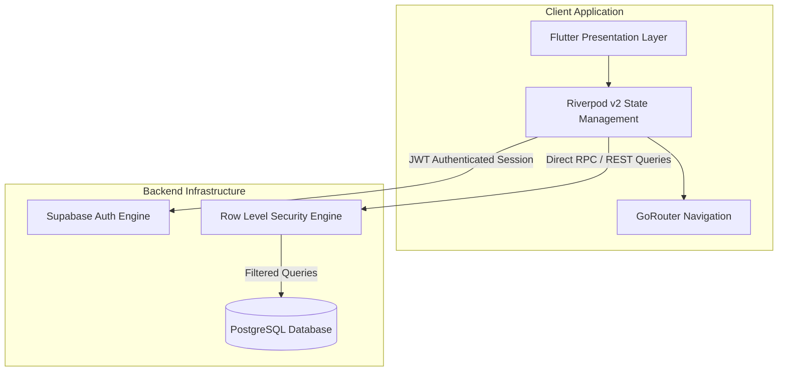
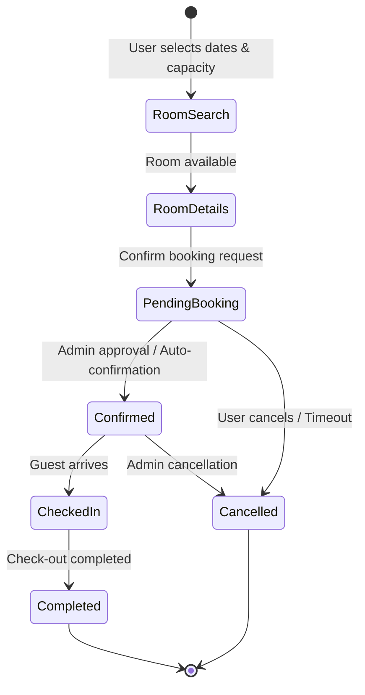
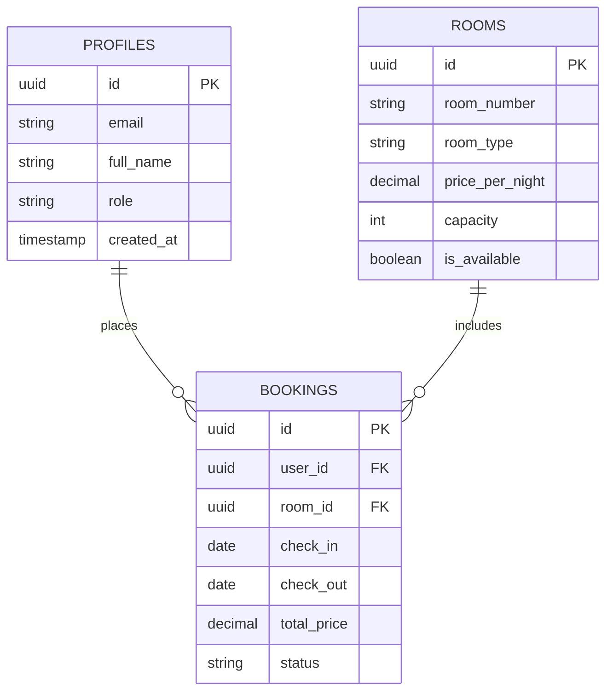

# Resort Booking App

<div align="center">

[](https://flutter.dev)
[](https://dart.dev)
[](https://supabase.com)
[](https://github.com/Midhun-M-git/Resort_app/actions/workflows/analyze.yml)
[](LICENSE)

</div>

A full-stack cross-platform luxury resort room booking application built with Flutter and Supabase. Features real-time availability checks, role-based admin oversight, and booking telemetry.

---

## Architecture and Dataflow



---

## Booking State Machine



---

## Features

### User Experience
- Register and login with Supabase Authentication
- Dynamic room directory filtered by category (Standard, Deluxe, Suite, Villa, Presidential)
- Granular room profiles detailing floor plan, capacity, amenities, and nightly pricing
- Real-time room availability verification against current reservations
- Date range picker with guest volume controls (Adults and Children)
- Automated price calculation engine including taxes and special requests
- Reservation history dashboard with real-time status tracking

### Administrative Controls
- Role-based access control protecting administrative endpoints
- Operational dashboard displaying total rooms, gross revenue, and occupancy rates
- Complete inventory CRUD management with instant status toggling
- Centralized booking oversight with filterable reservation records
- Administrative status transitions (Pending -> Confirmed -> Completed / Cancelled)

---

## Database Schema Overview



---

## Supported Platforms

- Android
- iOS
- Web
- Windows Desktop

---

## Getting Started

1. Clone the repository:
   ```bash
   git clone https://github.com/Midhun-M-git/Resort_app.git
   cd Resort_app
   ```

2. Install dependencies:
   ```bash
   flutter pub get
   ```

3. Set up Supabase:
   - Create a project on [supabase.com](https://supabase.com)
   - Execute the schema definitions from `supabase_schema.sql` in the SQL Editor
   - Copy your project URL and public anon key

4. Configure environment credentials in `.env`:
   ```env
   SUPABASE_URL=https://your-project.supabase.co
   SUPABASE_ANON_KEY=your-anon-key
   ```

5. Launch the application:
   ```bash
   flutter run
   ```

---

## Admin Configuration

To promote a registered account to Administrator:
1. Navigate to Supabase Dashboard -> Table Editor -> `profiles`.
2. Locate the target user row.
3. Update the `role` value from `user` to `admin`.

---

## License

This project is licensed under the MIT License. See the [LICENSE](LICENSE) file for details.
